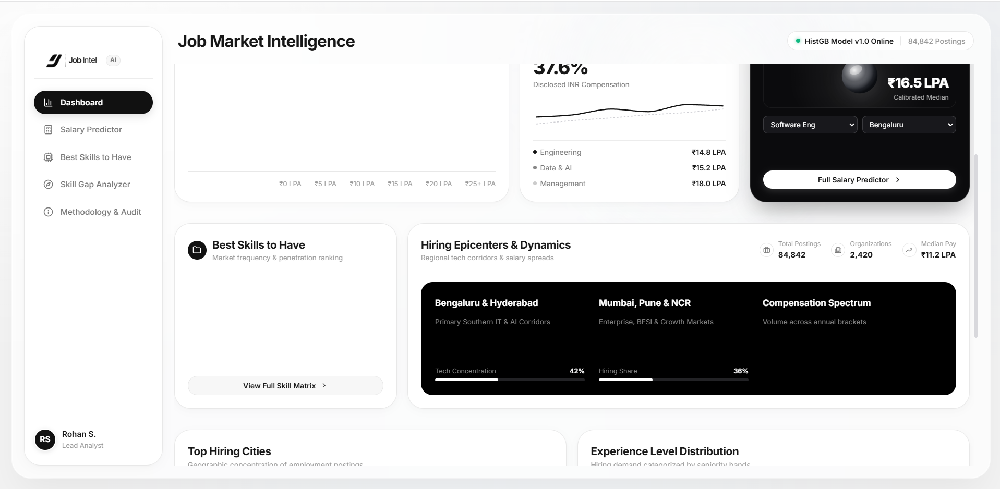
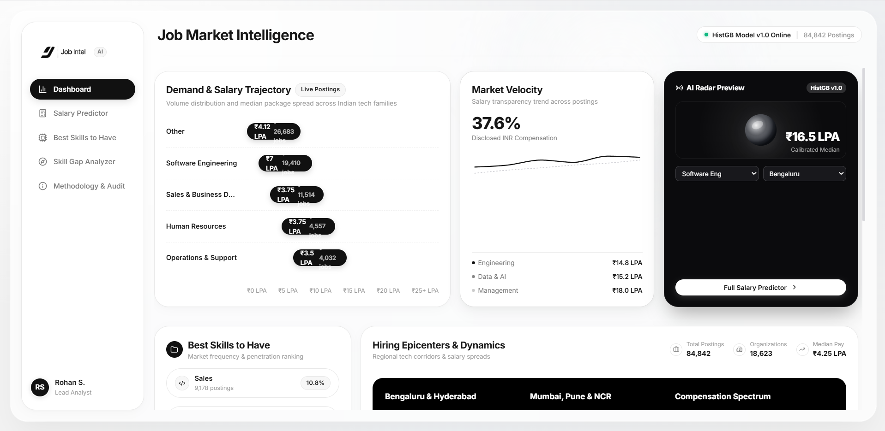
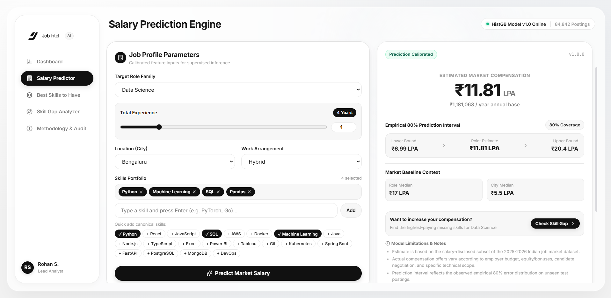
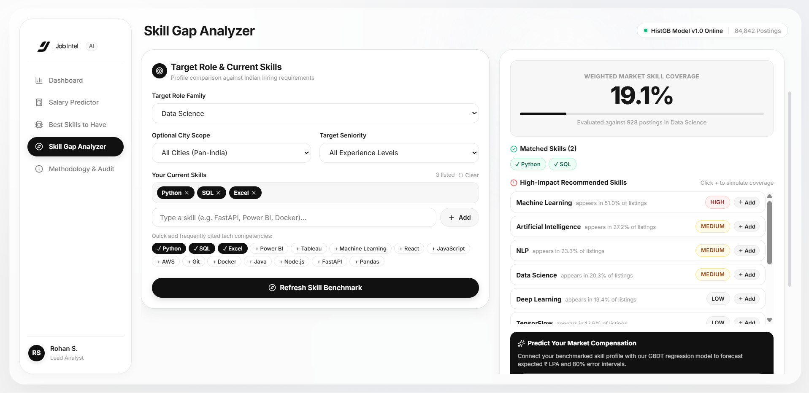
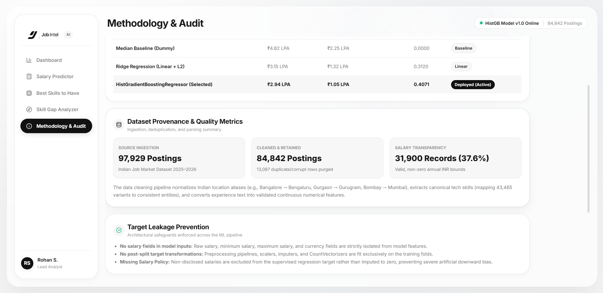

<div align="center">


# JobIntel AI — Indian Tech Market & Salary Analytics

**A production-grade Data Science & Machine Learning platform for Indian tech compensation forecasting, market skill intelligence, and personalized career gap benchmarking.**

[](https://python.org)
[](https://flask.palletsprojects.com/)
[](https://scikit-learn.org/)
[](https://react.dev/)
[](https://vite.dev/)
[](https://www.typescriptlang.org/)
[](LICENSE)

</div>

---

## 📸 Application Previews & Screenshots

### 1. Executive Market Intelligence Dashboard
Comprehensive high-level analytics over the Indian tech hiring ecosystem. Features the **Market Velocity** indicator (37.6% salary disclosure rate), cross-category benchmarks (Engineering vs. Data & AI vs. Management), and the **AI Radar Preview**.



---

### 2. Live Demand & Salary Trajectory Timeline
Interactive timeline charting volume distribution, median CTC (₹ LPA), and live job counts across Indian role families, alongside hiring epicenters (Southern IT Belt vs. Western & NCR Belt) and the 7-bracket compensation equalizer.



---

### 3. Supervised Salary Prediction Engine
Machine learning inference powered by `HistGradientBoostingRegressor` with a logarithmic `log1p` target transformation. Evaluates role, continuous experience, city, work arrangement, and skills portfolio to estimate median compensation and empirical 80% confidence error intervals ($[-40.8\%, +72.8\%]$).



---

### 4. Interactive Skill Gap Analyzer
Personalized career benchmark computing a weighted market coverage percentage against active employer requirements. Features a real-time **`+ Add` simulator** on missing skills to instantly test how acquiring a skill boosts market readiness.



---

### 5. Methodology, Verification & Audit Report
Full transparency report featuring the supervised model benchmark comparison (Baseline vs. Ridge vs. HistGB), data cleaning audit (97,929 raw postings $\rightarrow$ 84,842 clean records), and strict target leakage prevention policies.



---

## 🏛️ System Architecture

```
Indian Job Postings Dataset (97,929 raw records)
        │
        ▼
Data Ingestion & Integrity Validation (scripts/inspect_dataset.py)
        │
        ▼
Cleaning & Normalization Pipeline (scripts/run_pipeline.py)
        ├──► jobs_clean.parquet (84,842 clean records retained)
        ├──► job_skills.parquet (751,404 skill pairs, 43,465 canonical skills)
        └──► job_market.db (SQLite database with indexed relations)
        │
        ├──────────────────────────────┬──────────────────────────────┐
        ▼                              ▼                              ▼
Analytics Service              Offline ML Training            Skill Gap Engine
(Aggregations & Filters)      (HistGradientBoosting)       (Weighted Prevalence)
        │                              │                              │
        └──────────────────────────────┴──────────────────────────────┘
                                       │
                                       ▼
                              Flask REST API (Port 5000)
                                       │
                                       ▼ HTTP/JSON Proxy
                              React 19 + Vite Frontend (Port 5173)
```

---

## 🚀 Key Modules & Capabilities

### 1. 💰 Supervised Salary Prediction (`/salary-predictor`)
- **Production Algorithm**: `HistGradientBoostingRegressor` with `TransformedTargetRegressor(func=np.log1p, inverse_func=np.expm1)`.
- **Inputs**: Role Family, Experience Slider (0–30 yrs), City (Bengaluru, Hyderabad, Mumbai, etc.), Work Mode (In-Office, Hybrid, Remote), Skills tag builder.
- **Calibrated 80% Error Bounds**: Non-negative prediction intervals calculated via empirical residual quantiles (`[-40.8%, +72.8%]`).
- **Quick Scenarios**: One-click presets for Junior SDE, Mid Data Scientist, Senior DevOps, and Analytics Lead.

### 2. ⚡ Best Skills to Have (`/skills`)
- **Domain Breakdown**: Filters rankings by target technical role family.
- **Segmentation**:
  - **Core Foundation (>25% prevalence)**: Mandatory baseline skills.
  - **Specialist Multipliers (<25% prevalence)**: High-yield compensation boosters.
- **Co-Occurrence Mining**: Uncovers technology pairs frequently required together in Indian job postings (e.g. *Python + SQL*, *Docker + Kubernetes*).

### 3. 🎯 Skill Gap Analyzer (`/skill-gap`)
- **Weighted Coverage Score**: Computes alignment percentage against live market demand.
- **5 Career Transition Presets**: Data Science Aspirant, Junior SDE, DevOps & Cloud, BI Analyst, Full-Stack Transition.
- **Interactive "+ Add" Simulator**: Click `+ Add` on any missing skill to immediately re-evaluate coverage.
- **Bridge to Salary Predictor**: Direct CTA to project compensation using your updated profile.

### 4. 📊 Executive Dashboard (`/`)
- Multi-dimensional filter capsule bar (Role Family, City, Seniority).
- Interactive Demand & Salary Trajectory timeline.
- Regional hiring epicenters (Southern IT Belt vs. Western & NCR Belt).
- Annual compensation spectrum equalizer across 7 brackets.

---

## 📊 Supervised Model Benchmarks (Held-out 20% Test Set)

| Model Architecture | Test MAE (LPA) | Median Abs Error (LPA) | RMSE (LPA) | $R^2$ Score | Status |
| :--- | :--- | :--- | :--- | :--- | :--- |
| **Median Baseline (Dummy)** | ₹4.82 LPA | ₹2.25 LPA | ₹9.55 LPA | 0.0000 | Baseline |
| **Ridge Regression (Linear + L2)** | ₹3.15 LPA | ₹1.32 LPA | ₹7.92 LPA | 0.3120 | Linear Model |
| **HistGradientBoostingRegressor** | **₹2.94 LPA** | **₹1.05 LPA** | **₹7.36 LPA** | **0.4071** | **Selected Production Model** |

- **Empirical 80% Residual Interval**: `[-40.8%, +72.8%]`
- **Target Variable**: `salary_midpoint_inr_annual = (salary_min + salary_max) / 2.0`
- **Target Leakage Prevention**: Salary bounds, currency, and raw compensation text are strictly isolated from model training features.

---

## ⚡ Quickstart Guide

### Option 1: One-Click Launchers (Recommended on Windows)

- **Command Prompt / File Explorer**: Double-click [`start.bat`](./start.bat).
- **PowerShell**: Run [`.\start.ps1`](./start.ps1).

This opens both backend and frontend servers in separate terminal sessions.

---

### Option 2: Manual Terminal Launch

#### Terminal 1 — Backend (Flask API on Port 5000)
```powershell
cd D:\0\DataScience
.\backend\.venv\Scripts\python.exe backend\run.py
```

#### Terminal 2 — Frontend (React + Vite on Port 5173)
```powershell
cd D:\0\DataScience\frontend
npm run dev
```

Open your browser at: **`http://localhost:5173/`**

---

## 🧪 Running Automated Tests

- **Backend Pytest Suite (20 tests)**:
  ```powershell
  cd D:\0\DataScience
  .\backend\.venv\Scripts\python.exe -m pytest backend\tests
  ```
- **Frontend Vitest Suite (Unit tests)**:
  ```powershell
  cd D:\0\DataScience\frontend
  npm test
  ```
- **Production Build Verification**:
  ```powershell
  cd D:\0\DataScience\frontend
  npm run build
  ```

---

## 📡 REST API Documentation

| Endpoint | Method | Description |
|---|---|---|
| `/api/health` | `GET` | Service status, model readiness, and dataset row count |
| `/api/analytics/summary` | `GET` | Aggregate stats (total postings, unique companies, median pay) |
| `/api/analytics/roles` | `GET` | Role family volume and median salary breakdown |
| `/api/analytics/locations` | `GET` | City- and state-level hiring distribution |
| `/api/analytics/salaries` | `GET` | Volume distribution across 7 salary brackets (LPA) |
| `/api/analytics/experience` | `GET` | Postings breakdown across experience seniority bands |
| `/api/analytics/skills` | `GET` | Ranked technical competencies with frequency and prevalence |
| `/api/analytics/filter-options` | `GET` | Available filter values for roles, cities, and experience |
| `/api/predictions/salary` | `POST` | Predict expected annual salary with 80% confidence interval |
| `/api/predictions/metadata` | `GET` | Model hyperparameters, training date, and validation metrics |
| `/api/skills/recommend` | `POST` | Skill gap analysis, coverage score %, and prioritized gaps |

---

## ⚖️ Responsible Use & Limitations

1. **Statistical Guidance**: Salary predictions represent estimated statistical distributions based on verified historical postings; they do not constitute guaranteed compensation offers.
2. **Disclosure Selection Bias**: Employers that publicly disclose compensation ranges may differ in size or compensation structure from those that negotiate privately.
3. **Skill Gap Score**: Market coverage reflects alignment with skills frequently cited in active job descriptions, not a measure of individual proficiency.
